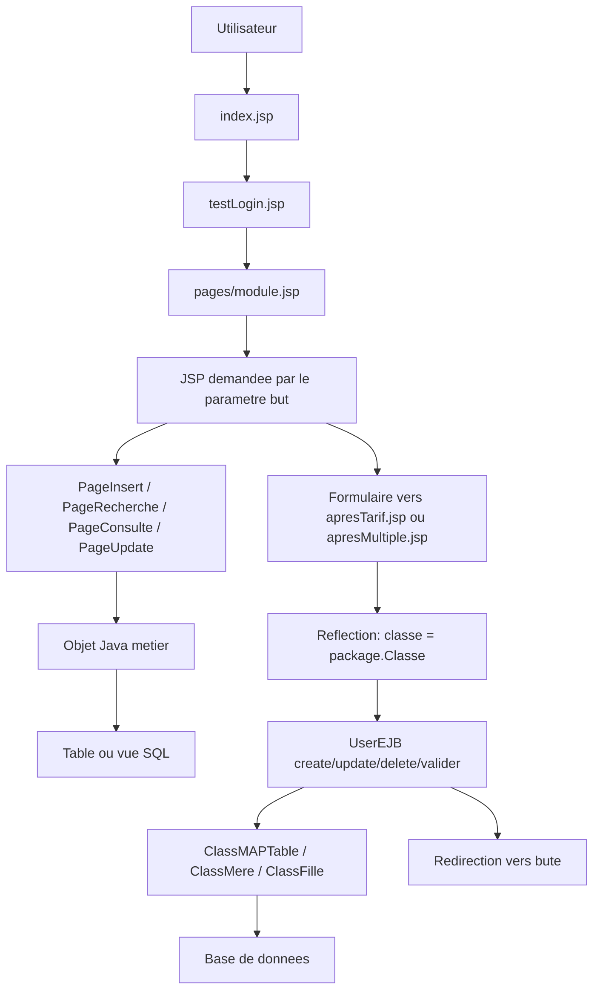

# Documentation technique du projet standard

Derniere mise a jour : 07/10/2026

Ce document explique la structure du projet, la logique generale de fonctionnement et la maniere de creer les pages JSP avec les frameworks personnalises `apj-core.jar` et `apj-core2.jar`.

## 1. Vue d'ensemble

Le projet est une application Java EE / JSP d'ERP appelee ici `arbiochem`. Elle est organisee autour de deux modules principaux :

- `arbiochem-ejb` : contient les classes metier, les objets qui correspondent aux tables ou aux vues de la base, les validations, les traitements et les regles metier.
- `arbiochem-war` : contient les pages JSP, les assets web, les servlets specifiques et la configuration web.

Le projet utilise Ant pour compiler et deployer :

- `../build.xml` : build/deploiement vers WildFly, en WAR explose `async-standard.war`.
- `../build-tomcat.xml` : build/deploiement vers Tomcat, sous le contexte `/arbiochem`.
- `../build-file/lib` : contient les dependances, dont `apj-core.jar` et `apj-core2.jar`.

Les pages ne sont pas des pages JSP isolees appelees directement. Elles passent par une page conteneur :

```text
index.jsp
  -> pages/testLogin.jsp
  -> pages/module.jsp?but=chemin/page.jsp&currentMenu=...
       -> inclut la JSP demandee avec <jsp:include page="<%=but%>"/>
```

La variable `but` indique la page a afficher dans le layout principal.

## 2. Structure importante

```text
projet-standard/
  arbiochem-ejb/
    src/java/
      annexe/
      produits/
      faturefournisseur/
      ferme/
      stock/
      vente/
      maintenance/
      ...

  arbiochem-war/
    src/java/
      servlet/
      station/export/
      filemanager/
      ...
    web/
      index.jsp
      WEB-INF/web.xml
      WEB-INF/META-INF/apj/web-fragment.xml
      pages/
        module.jsp
        apresTarif.jsp
        apresMultiple.jsp
        annexe/
        produits/
        bondecommande/
        bondelivraison/
        ferme/
        maintenance/
        ...

  build-file/
    lib/
      apj-core.jar
      apj-core2.jar
      ...
```

`../arbiochem-ejb/src/java` est la partie logique. Les classes y definissent les attributs, la table SQL, la generation de cle primaire, les validations et les traitements.

`../arbiochem-war/web/pages` est la partie interface. Les JSP utilisent les classes du framework APJ pour generer automatiquement les formulaires, les listes, les fiches et les pages de modification.

## 3. Role des JAR APJ

Les deux JAR sont des frameworks internes. Ils evitent d'ecrire manuellement tout le CRUD, les formulaires HTML, les tableaux, les recherches, les listes deroulantes et une grande partie des operations base de donnees.

### `apj-core.jar`

Ce JAR apporte surtout les bases metier et affichage :

- `bean.ClassMAPTable` : classe de base des objets persistants. Elle gere le nom de table, la cle primaire, les insertions, les mises a jour, les suppressions, les recherches, l'historique et la reflexion sur les attributs.
- `bean.ClassEtat` : extension pour les objets qui ont un etat, avec validation, annulation, cloture, etc.
- `bean.ClassMere` : classe mere pour une saisie avec lignes filles.
- `bean.ClassFille` : classe fille reliee a une classe mere.
- `bean.TypeObjet` : classe pratique pour les tables de reference de type `id`, `val`, `desce`.
- `bean.CGenUtil` : utilitaire de recherche generique en base.
- `affichage.PageInsert` : generation d'un formulaire d'insertion.
- `affichage.PageRecherche` : generation d'une page de recherche/liste.
- `affichage.PageConsulte` : generation d'une fiche de consultation.
- `affichage.PageUpdate` : generation d'un formulaire de modification.
- `affichage.PageInsertMultiple` et `PageUpdateMultiple` : generation de formulaires mere/fille.
- `affichage.Champ` : configuration d'un champ HTML.
- `affichage.Liste` : champ liste deroulante alimente par une table ou une vue.

### `apj-core2.jar`

Ce JAR complete la partie web et services transverses :

- `user.UserEJB` : facade utilisee par les JSP pour appeler les operations metier.
- `web.servlet.AutoComplete` : endpoint `/autocomplete`.
- `web.servlet.Deroulante` : endpoint `/Deroulante` pour les listes dependantes.
- `web.servlet.ServletDownload` : endpoint `/download`.
- classes de menu, utilisateur, notification, reporting, import, QR code, impression PDF.

Dans `../arbiochem-war/web/WEB-INF/web.xml`, les servlets APJ sont declares :

```xml
<servlet>
    <servlet-name>AutoComplete</servlet-name>
    <servlet-class>web.servlet.AutoComplete</servlet-class>
</servlet>
<servlet-mapping>
    <servlet-name>AutoComplete</servlet-name>
    <url-pattern>/autocomplete</url-pattern>
</servlet-mapping>

<servlet>
    <servlet-name>Deroulante</servlet-name>
    <servlet-class>web.servlet.Deroulante</servlet-class>
</servlet>
<servlet-mapping>
    <servlet-name>Deroulante</servlet-name>
    <url-pattern>/Deroulante</url-pattern>
</servlet-mapping>
```

Le fichier `WEB-INF/META-INF/apj/web-fragment.xml` declare aussi des servlets APJ comme `Deroulante`, `ServletDownload` et `ImportUtilServlet`.

## 4. Logique generale d'une requete

Le fonctionnement standard d'une page est le suivant :



La JSP sert surtout a configurer l'affichage. La logique importante doit rester dans la classe Java metier.

## 5. Logique cote Java

Chaque objet metier suit presque toujours ce modele :

1. Il herite d'une classe APJ.
2. Il declare les attributs qui correspondent aux colonnes SQL.
3. Le constructeur indique la table ou la vue avec `setNomTable`.
4. `construirePK(Connection c)` definit le prefixe et la sequence.
5. `getTuppleID()` retourne la valeur de la cle primaire.
6. `getAttributIDName()` retourne le nom de l'attribut identifiant, souvent `"id"`.
7. Les setters et `controler(Connection c)` portent les validations.
8. Les traitements speciaux se font en surchargeant `createObject`, `updateToTableWithHisto`, `validerObject`, etc.

Exemple simple avec `annexe.Unite` :

```java
public class Unite extends TypeObjet {
    public Unite() {
        this.setNomTable("UNITE");
    }

    @Override
    public void construirePK(Connection c) throws Exception {
        this.preparePk("UNT", "getSeqUnite");
        this.setId(makePK(c));
    }
}
```

Exemple plus metier avec `annexe.Produit` :

- herite de `ClassEtat`, donc l'objet peut avoir un etat ;
- mappe la table `Produit` ;
- genere une cle `PRD` avec `getSeqProduit` ;
- valide que le prix de vente est superieur a 0 dans `controler` ;
- cree un historique produit et un inventaire zero apres insertion.

Exemple mere/fille avec `produits.RecetteMere` et `produits.RecetteFille` :

```java
public class RecetteMere extends ClassMere {
    public RecetteMere() throws Exception {
        this.setNomTable("RECETTE_MERE");
        this.setNomClasseFille("produits.RecetteFille");
        this.setLiaisonFille("idMere");
    }
}
```

```java
public class RecetteFille extends ClassFille {
    public RecetteFille() throws Exception {
        this.setNomTable("RECETTE_FILLE");
        this.setNomClasseMere("produits.RecetteMere");
        this.setLiaisonMere("idMere");
    }
}
```

La mere connait la classe fille et la colonne de liaison. La fille connait la classe mere et la meme colonne de liaison.

## 6. Exemples de logique metier existante

### Bon de commande fournisseur

Classes principales :

- `faturefournisseur.As_BonDeCommande`
- `faturefournisseur.As_BonDeCommande_Fille`
- `faturefournisseur.As_BonDeCommandeCpl`
- `faturefournisseur.As_BonDeCommande_Fille_CPL`

`As_BonDeCommande` herite de `ClassMere`. Sa table est `AS_BONDECOMMANDE`. Sa fille est `faturefournisseur.As_BonDeCommande_Fille`, reliee par `idbc`.

Elle contient des traitements metier comme :

- generation de facture depuis une commande ;
- generation de bon de livraison ;
- recuperation des lignes restantes a livrer ;
- controle de coherence de devise entre la mere et les filles.

### Bon de livraison fournisseur

Classes principales :

- `faturefournisseur.As_BonDeLivraison`
- `faturefournisseur.As_BonDeLivraison_Fille`
- `faturefournisseur.As_BonDeLivraison_Lib`
- `faturefournisseur.As_BonDeLivraison_Fille_Cpl`

`As_BonDeLivraison_Fille` herite de `ClassFille`. Elle est reliee a `As_BonDeLivraison` par `numbl`. Elle peut generer des lignes de mouvement de stock et des details de facture fournisseur.

### Recette produit

Classes principales :

- `produits.Recette`
- `produits.RecetteLib`
- `produits.RecetteMere`
- `produits.RecetteFille`
- `produits.RecetteFilleLib`

`Recette` herite de `ClassMAPTable` et mappe `AS_RECETTE`. Elle contient la logique de decomposition de recette, de calcul de revient, de generation de ligne de fabrication et de controle contre les cycles de composition.

### Reception poussin aeroport

Classes principales :

- `ferme.receptionaeroport.ReceptionPoussinAeroport`
- `ferme.receptionaeroport.ReceptionPoussinAeroportDetail`

`ReceptionPoussinAeroport` herite de `ClassMere`. Elle mappe `receptionPoussinAeroport`, utilise la fille `ReceptionPoussinAeroportDetail` et la liaison `idMere`.

La methode `createObject` verifie notamment :

- le bon de livraison est obligatoire ;
- la date de reception est obligatoire ;
- la quantite recue ne depasse pas la quantite du bon de livraison ;
- le bon de livraison doit contenir un seul produit ;
- un lot est cree automatiquement a partir du produit et du bon de livraison ;
- la somme des quantites vivantes et mortes correspond a la quantite recue.

### Triage batiment/parquet

Classes principales :

- `ferme.triageBatiment.TriageBatimentParquet`
- `ferme.triageBatiment.TriageBatimentParquetDetail`
- `ferme.triageBatiment.TriageBatimentParquetLib`
- `ferme.triageBatiment.TriageLotSexeQualite`

`TriageBatimentParquet` herite de `ClassMere`. Elle mappe `TRIAGEBATIMENTPARQUET`, utilise la fille `TriageBatimentParquetDetail` et la liaison `idmere`.

La methode `createObject` verifie notamment :

- la reception aeroport est obligatoire ;
- la reception doit exister ;
- le lot est repris depuis la reception ;
- la quantite theorique est calculee avec `qteRecus - morts` de la reception aeroport ;
- les morts et pertes au triage ne peuvent pas etre negatifs ;
- la sante d'une ligne doit etre entre 1 et 10 ;
- la quantite repartie dans les parquets ne doit pas depasser la quantite vivante restante.

## 7. Types de JSP

Le projet utilise plusieurs types de pages, avec une convention de nommage claire.

### Page de saisie : `*-saisie.jsp`

Objectif : afficher un formulaire d'insertion.

Classe APJ principale : `PageInsert`.

Exemple : `pages/annexe/unite/unite-saisie.jsp`

```jsp
<%@page import="annexe.Unite"%>
<%@page import="affichage.PageInsert"%>
<%@page import="user.UserEJB"%>

<%
    UserEJB u = (user.UserEJB) session.getValue("u");
    String mapping = "annexe.Unite";
    String nomtable = "UNITE";
    String apres = "annexe/unite/unite-fiche.jsp";

    Unite unite = new Unite();
    unite.setNomTable("UNITE");

    PageInsert pi = new PageInsert(unite, request, u);
    pi.setLien((String) session.getValue("lien"));
    pi.getFormu().getChamp("val").setLibelle("Designation");
    pi.getFormu().getChamp("desce").setLibelle("Description");
    pi.preparerDataFormu();
%>

<form action="<%=pi.getLien()%>?but=apresTarif.jsp" method="post">
    <%
        pi.getFormu().makeHtmlInsertTabIndex();
        out.println(pi.getFormu().getHtmlInsert());
    %>
    <input name="acte" type="hidden" value="insert">
    <input name="bute" type="hidden" value="<%=apres%>">
    <input name="classe" type="hidden" value="<%=mapping%>">
    <input name="nomtable" type="hidden" value="<%=nomtable%>">
</form>
```

Les champs caches sont essentiels :

- `acte=insert` : demande une insertion.
- `bute=...` : page de redirection apres traitement.
- `classe=...` : classe Java a instancier par reflection.
- `nomtable=...` : table cible si elle doit etre forcee.

### Page de liste : `*-liste.jsp`

Objectif : afficher un formulaire de recherche et un tableau.

Classe APJ principale : `PageRecherche`.

Exemple : `pages/annexe/unite/unite-liste.jsp`

```jsp
Unite t = new Unite();
t.setNomTable("UNITE");

String listeCrt[] = {"id", "val", "desce"};
String listeInt[] = {};
String libEntete[] = {"id", "val", "desce"};

PageRecherche pr = new PageRecherche(t, request, listeCrt, listeInt, 3, libEntete, libEntete.length);
pr.setUtilisateur((user.UserEJB) session.getValue("u"));
pr.setLien((String) session.getValue("lien"));
pr.setApres("annexe/unite/unite-liste.jsp");
pr.creerObjetPage(libEntete, null);

String lienTableau[] = {pr.getLien() + "?but=annexe/unite/unite-fiche.jsp"};
String colonneLien[] = {"id"};
pr.getTableau().setLien(lienTableau);
pr.getTableau().setColonneLien(colonneLien);
out.println(pr.getTableau().getHtml());
```

Parametres importants :

- `listeCrt` : champs disponibles dans le formulaire de recherche.
- `listeInt` : champs recherches en intervalle, par exemple montant min/max.
- `libEntete` : colonnes affichees dans le tableau.
- `setLien` + `setColonneLien` : rend une colonne cliquable vers la fiche.
- `setLibelleAffiche` : renomme les entetes du tableau.

### Page fiche : `*-fiche.jsp`

Objectif : afficher le detail d'un enregistrement.

Classe APJ principale : `PageConsulte`.

Exemple : `pages/annexe/unite/unite-fiche.jsp`

```jsp
Unite unite = new Unite();
unite.setNomTable("UNITE");

PageConsulte pc = new PageConsulte(unite, request, u);
pc.setTitre("Fiche de l'unite");
pc.getChampByName("val").setLibelle("Designation");
pc.getChampByName("desce").setLibelle("Description");

out.println(pc.getHtml());
out.println(pc.getBasPage());
```

La fiche lit l'identifiant depuis la requete, generalement `id`, puis charge l'objet.

### Page modification : `*-modif.jsp`

Objectif : afficher un formulaire pre-rempli pour update.

Classe APJ principale : `PageUpdate`.

Exemple : `pages/annexe/unite/unite-modif.jsp`

```jsp
Unite t = new Unite();
PageUpdate pu = new PageUpdate(t, request, (user.UserEJB) session.getValue("u"));
pu.setLien((String) session.getValue("lien"));
pu.getFormu().getChamp("id").setAutre("readonly");
pu.preparerDataFormu();
```

Le formulaire poste vers `apresTarif.jsp` :

```html
<input name="acte" type="hidden" value="update">
<input name="bute" type="hidden" value="annexe/unite/unite-fiche.jsp">
<input name="classe" type="hidden" value="annexe.Unite">
<input name="rajoutLien" type="hidden" value="id-...">
<input name="nomtable" type="hidden" value="UNITE">
```

## 8. Traitement des formulaires

### `apresTarif.jsp`

Cette page traite les actions simples.

Elle lit :

- `acte`
- `classe`
- `nomtable`
- `bute`
- `id`
- `rajoutLien`

Puis elle instancie la classe :

```java
ClassMAPTable t = (ClassMAPTable) (Class.forName(classe).newInstance());
```

Selon `acte`, elle appelle `UserEJB` :

- `insert` : `u.createObject(f)`
- `update` : `u.updateObject(f)`
- `delete` : `u.deleteObject(t)`
- `valider` : `u.validerObject(t)`
- `annuler` : `u.annulerObject(t)`
- `annulerVisa` : `u.annulerVisa(t)`
- `cloturer` : `u.cloturerObject(t)`
- `payer` : `u.payerObject(t)`
- `dupliquer` : `u.dupliquerObject(...)`

Ensuite elle redirige vers la page `bute`.

### `apresMultiple.jsp`

Cette page traite les actions avec plusieurs lignes ou avec relation mere/fille.

Elle gere notamment :

- `insert` avec mere/fille ;
- `insertFille` ;
- `updateInsert` ;
- `updateMultiple` ;
- `deleteMultiple` ;
- `validerMultiple`.

Pour une insertion mere/fille, elle utilise :

- `classe` : classe mere ;
- `classefille` : classe fille ;
- `nomtable` : table des filles ;
- `nombreLigne` : nombre de lignes du tableau ;
- `colonneMere` : colonne de liaison dans la fille.

## 9. Creer une nouvelle fonctionnalite simple

Exemple : creer une gestion `Categorie`.

### Etape 1 : creer la table SQL

```sql
CREATE TABLE CATEGORIE (
    ID VARCHAR2(50) PRIMARY KEY,
    VAL VARCHAR2(255),
    DESCE VARCHAR2(255)
);
```

Prevoir aussi une sequence ou une fonction compatible avec `preparePk`.

### Etape 2 : creer la classe Java

```java
package annexe;

import bean.TypeObjet;
import java.sql.Connection;

public class Categorie extends TypeObjet {
    public Categorie() {
        this.setNomTable("CATEGORIE");
    }

    @Override
    public void construirePK(Connection c) throws Exception {
        this.preparePk("CAT", "getSeqCategorie");
        this.setId(makePK(c));
    }
}
```

Si la table n'est pas seulement `id`, `val`, `desce`, utiliser plutot `ClassMAPTable` ou `ClassEtat`.

### Etape 3 : creer `categorie-saisie.jsp`

Utiliser `PageInsert`, configurer les libelles, puis poster vers `apresTarif.jsp`.

### Etape 4 : creer `categorie-liste.jsp`

Utiliser `PageRecherche`, definir `listeCrt`, `listeInt`, `libEntete`, puis ajouter un lien vers la fiche.

### Etape 5 : creer `categorie-fiche.jsp`

Utiliser `PageConsulte` pour afficher l'objet et ajouter les boutons modifier/supprimer si necessaire.

### Etape 6 : creer `categorie-modif.jsp`

Utiliser `PageUpdate`, mettre l'id en lecture seule, puis poster vers `apresTarif.jsp` avec `acte=update`.

### Etape 7 : ajouter l'entree menu

L'application utilise `MenuDynamique` et les menus sont charges en session dans `pages/elements/menu/module.jsp`. La page est appelee via une URL de cette forme :

```text
pages/module.jsp?but=annexe/categorie/categorie-liste.jsp&currentMenu=...
```

## 10. Creer une page mere/fille

Une fonctionnalite mere/fille est utilisee quand une entite principale contient plusieurs lignes de detail : bon de commande + lignes, livraison + lignes, recette mere + ingredients, triage + details, etc.

### Etape 1 : classe mere

```java
public class ExempleMere extends ClassMere {
    private String id;
    private Date daty;

    public ExempleMere() throws Exception {
        this.setNomTable("EXEMPLE_MERE");
        this.setNomClasseFille("package.ExempleFille");
        this.setLiaisonFille("idMere");
    }

    public void construirePK(Connection c) throws Exception {
        this.preparePk("EXM", "getSeqExempleMere");
        this.setId(makePK(c));
    }

    public String getTuppleID() { return id; }
    public String getAttributIDName() { return "id"; }
}
```

### Etape 2 : classe fille

```java
public class ExempleFille extends ClassFille {
    private String id;
    private String idMere;
    private String produit;
    private double quantite;

    public ExempleFille() throws Exception {
        this.setNomTable("EXEMPLE_FILLE");
        this.setNomClasseMere("package.ExempleMere");
        this.setLiaisonMere("idMere");
    }

    public String getNomClasseMere() { return "package.ExempleMere"; }
    public String getLiaisonMere() { return "idMere"; }
    public String getTuppleID() { return id; }
    public String getAttributIDName() { return "id"; }
}
```

### Etape 3 : JSP de saisie multiple

Utiliser `PageInsertMultiple`.

```jsp
ExempleMere mere = new ExempleMere();
ExempleFille fille = new ExempleFille();
int taille = 5;

PageInsertMultiple pi = new PageInsertMultiple(mere, fille, request, taille, u);
pi.setLien((String) session.getValue("lien"));
pi.preparerDataFormu();
pi.getFormu().makeHtmlInsertTabIndex();
pi.getFormufle().makeHtmlInsertTableauIndex();
```

Le formulaire doit poster vers `apresMultiple.jsp` :

```html
<input name="acte" type="hidden" value="insert">
<input name="bute" type="hidden" value="exemple/exemple-fiche.jsp">
<input name="classe" type="hidden" value="package.ExempleMere">
<input name="classefille" type="hidden" value="package.ExempleFille">
<input name="nomtable" type="hidden" value="EXEMPLE_FILLE">
<input name="nombreLigne" type="hidden" value="5">
<input name="colonneMere" type="hidden" value="idMere">
```

## 11. Configuration des champs dans les JSP

Les objets APJ generent les champs automatiquement a partir des attributs Java. Ensuite la JSP personnalise ces champs.

### Changer le libelle

```java
pi.getFormu().getChamp("val").setLibelle("Designation");
```

### Champ en lecture seule

```java
pu.getFormu().getChamp("id").setAutre("readonly");
```

### Valeur par defaut

```java
pi.getFormu().getChamp("idProduit").setDefaut(request.getParameter("id"));
```

### Cacher un champ

```java
pc.getChampByName("idingredients").setVisible(false);
```

### Liste deroulante depuis une table

```java
TypeObjet unite = new TypeObjet();
unite.setNomTable("AS_UNITE");
Champ[] liste = new Champ[1];
liste[0] = new Liste("unite", unite, "VAL", "id");
pi.getFormu().changerEnChamp(liste);
```

### Fenetre de choix

```java
pi.getFormu().getChamp("idproduits").setPageAppel("choix/listeProduitChoix.jsp");
```

### Autocomplete avec retour de plusieurs colonnes

```java
Champ.setPageAppelComplete(
    pi.getFormufle().getChampFille("idIngredient"),
    "produits.IngredientVente",
    "id",
    "as_ingredients_lib",
    "idUnite;unite",
    "idUnite;idUniteLib"
);
```

Ici, le choix d'un ingredient remplit aussi l'unite.

## 12. Tables et vues

Le framework fait souvent une distinction entre :

- table physique pour insertion/modification, par exemple `AS_RECETTE`, `UNITE`, `TRIAGEBATIMENTPARQUET`;
- vue ou table libellee pour affichage, par exemple `AS_RECETTE_LIBCOMPLET`, `RECETTE_FILLE_LIB`, `as_bondecommande_livre`.

Convention courante :

- la classe de base mappe la vraie table ;
- une classe `Lib`, `Cpl` ou `CPL` etend la classe de base et mappe une vue plus riche ;
- les pages liste/fiche utilisent souvent la vue ;
- les pages insertion/modification utilisent la table principale.

Exemple :

```java
RecetteLib lv = new RecetteLib();
lv.setNomTable("AS_RECETTE_LIBCOMPLET");
```

Cette pratique permet d'afficher des libelles calcules ou joints sans changer la table d'insertion.

## 13. Regles importantes pour ajouter de la logique

Mettre les validations dans Java, pas seulement dans la JSP.

Bon emplacement :

- setter, si la validation concerne un seul champ ;
- `controler(Connection c)`, si la validation concerne l'objet avant insertion/update ;
- `createObject(String u, Connection c)`, si la creation doit declencher d'autres traitements ;
- `validerObject`, `annulerVisa`, `cloturerObject`, si la regle concerne le cycle d'etat.

Exemples existants :

- `Produit.controler` refuse un prix de vente inferieur ou egal a 0.
- `Recette.controler` empeche un produit d'etre compose de lui-meme.
- `ReceptionPoussinAeroport.createObject` cree automatiquement un lot et verifie les quantites.
- `TriageBatimentParquet.createObject` controle la reception, le lot, les pertes, la sante et les quantites reparties.

## 14. Points d'attention

### Package Java et champ `classe`

Le champ cache `classe` doit correspondre exactement au package compile.

Exemple :

```html
<input name="classe" value="annexe.Unite">
```

Si le package est faux, `apresTarif.jsp` echouera au moment de `Class.forName(classe)`.

### Nom des attributs

Les noms des champs JSP doivent correspondre aux noms des attributs Java.

Exemple : si la classe contient `private String idProduit`, le champ APJ sera normalement `idProduit`.

### Nom de table

Toujours verifier :

- table d'insertion dans la classe ou dans `nomtable` ;
- vue d'affichage dans les pages liste/fiche ;
- table fille dans `apresMultiple.jsp`.

### Encodage

Le build compile avec `encoding="iso-8859-1"` dans Ant, mais plusieurs JSP utilisent `UTF-8`. Des textes peuvent apparaitre abimes si le fichier n'est pas enregistre avec le bon encodage. Pour les nouvelles JSP, garder une convention claire :

```jsp
<%@ page pageEncoding="UTF-8" contentType="text/html; charset=UTF-8" %>
```

Puis enregistrer le fichier en UTF-8.

### SQL manuel

Certaines recherches utilisent `aWhere` avec des chaines SQL. Il faut eviter de mettre directement une valeur utilisateur dedans sans controle. Quand c'est inevitable, verifier le format attendu avant de construire la condition.

## 15. Checklist pour realiser une nouvelle page JSP

1. Creer ou identifier la table SQL.
2. Creer la classe Java dans `../arbiochem-ejb/src/java`.
3. Heriter de `ClassMAPTable`, `ClassEtat`, `TypeObjet`, `ClassMere` ou `ClassFille` selon le besoin.
4. Ajouter `setNomTable` dans le constructeur.
5. Implementer `construirePK`, `getTuppleID`, `getAttributIDName`.
6. Ajouter les validations dans les setters, `controler` ou `createObject`.
7. Creer `*-saisie.jsp` avec `PageInsert`.
8. Creer `*-liste.jsp` avec `PageRecherche`.
9. Creer `*-fiche.jsp` avec `PageConsulte`.
10. Creer `*-modif.jsp` avec `PageUpdate` si la modification est autorisee.
11. Pour une saisie mere/fille, utiliser `PageInsertMultiple` et `apresMultiple.jsp`.
12. Ajouter les boutons et liens vers les pages avec `module.jsp?but=...`.
13. Ajouter l'entree de menu si la page doit etre accessible depuis le menu lateral.
14. Compiler avec Ant.
15. Tester insertion, liste, fiche, modification, suppression et validation si l'objet a un etat.

## 16. Commandes de build

Pour WildFly :

```bash
ant -f build.xml deploy
```

Pour Tomcat :

```bash
ant -f build-tomcat.xml deploy
```

Le build effectue principalement ces operations :

1. nettoie les dossiers de build ;
2. copie `../arbiochem-war/web` vers le WAR explose ;
3. copie les JAR de `../build-file/lib` vers `WEB-INF/lib` ;
4. compile `../arbiochem-ejb/src/java` ;
5. genere `arbiochem-ejb.jar` ;
6. copie ce JAR dans `WEB-INF/lib` ;
7. compile `../arbiochem-war/src/java` ;
8. copie les fichiers properties ;
9. deploye l'application.

## 17. Resume pratique

Le projet fonctionne comme un framework CRUD maison :

- les classes Java representent les tables ;
- `ClassMAPTable` sait inserer, modifier, supprimer et rechercher par reflexion ;
- `ClassMere` et `ClassFille` gerent les ecrans avec lignes de detail ;
- les JSP ne codent pas tout le HTML a la main, elles configurent des objets `PageInsert`, `PageRecherche`, `PageConsulte`, `PageUpdate` ;
- les formulaires postent vers `apresTarif.jsp` ou `apresMultiple.jsp` ;
- ces pages instancient la classe indiquee dans le champ cache `classe`, remplissent l'objet avec les parametres de la requete, puis appellent `UserEJB` ;
- la vraie logique metier est dans les classes Java : validations, calculs, creation automatique d'autres objets, generation de mouvements, factures, lots, etc.

Pour travailler proprement dans ce projet, il faut donc toujours penser en trois morceaux :

```text
Classe Java metier  ->  JSP d'affichage  ->  apresTarif/apresMultiple pour sauvegarder
```

Si la classe Java est bien definie, les pages JSP deviennent assez rapides a creer car APJ genere deja la plupart des formulaires et tableaux.
